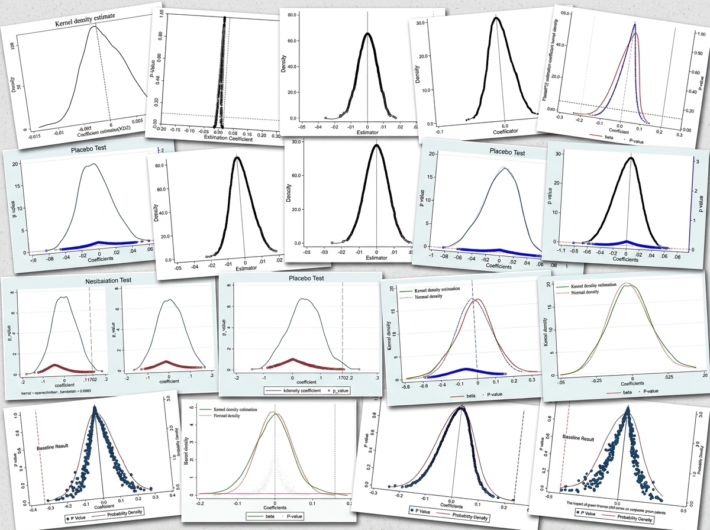

I am back, once again, to discuss ``placebo treatment'' graphs.

I wrote [this thread](https://x.com/kylefbutts/status/2119804888800788623?a=\_2htsnoNP_40G17ZWZM&s=20) a few weeks ago about a causal inference 'paper mill' I have run into because of constant referee requests.
Since then I've been asked to review two more (one per week!) that do the same thing.
But, what inspired this blog post is that they made a [Stata module](https://ideas.repec.org/c/boc/bocode/s459225.html) to make these dumb graphs even easier to make!
Just to show you how severe this is, I did a quick google search "green innovation zones china economics paper" and just started opening links:

<!--
https://www.sciencedirect.com/science/article/pii/S1043951X22001328#f0020
https://www.nature.com/articles/s41599-026-06925-6/figures/5
https://www.pjoes.com/Green-Innovation-Effect-of-Public-Resource-nTrading-Centers-An-Empirical-Study-Based,171682,0,2.html#gallery-3
https://www.sciencedirect.com/science/article/pii/S2210670723003414
https://www.sciencedirect.com/science/article/pii/S1470160X24005946
https://www.frontiersin.org/journals/environmental-science/articles/10.3389/fenvs.2022.870019/full
https://www.cell.com/heliyon/fulltext/S2405-8440(23)08287-7#fig2
https://onlinelibrary.wiley.com/doi/full/10.1111/ajes.12633
https://journals.plos.org/plosone/article?id=10.1371/journal.pone.0268111
https://link.springer.com/article/10.1007/s11356-023-25803-1
https://link.springer.com/article/10.1007/s11356-022-22886-0/figures/5
https://onlinelibrary.wiley.com/doi/full/10.1111/ajes.12573
https://link.springer.com/article/10.1007/s11356-023-26758-z/figures/4
https://www.mdpi.com/2071-1050/16/21/9570
https://link.springer.com/article/10.1007/s10668-025-07259-0/figures/4
https://www.sciencedirect.com/science/article/pii/S0140988324004602
https://www.sciencedirect.com/science/article/pii/S0301479722010386#fig2
https://www.sciencedirect.com/science/article/pii/S1544612325015740
https://www.sciencedirect.com/science/article/pii/S0959652624030221#bib24
https://www.sciencedirect.com/science/article/pii/S0140988322001098?via%3Dihub#f0010
https://www.sciencedirect.com/science/article/pii/S1544612323012217
https://www.mdpi.com/2071-1050/18/19/10141
https://www.frontiersin.org/journals/environmental-science/articles/10.3389/fenvs.2022.896661/full
--> 

What I'm showing here is a set of 18 different papers that all are doing the same "robustness check" (among other things).
The idea for this "robustness check" comes from the Fisher randomization inference approach where you randomly shuffle treatment and estimate placebo treatment effects.
The distribution of the placebo treatment effects serve as the reference sample distribution under the null hypothesis. 
This method is valid specifically when you have complete random assignment of treatment.
To be clear, this is not a form of a robustness check. 
It is a way to quantify the sample distribution and to do statistical inference on the estimate, i.e. get a p-value on your estimate.

If you think about the Fisher randomization procedure, the distributions should always be centered at zero. 
You're asking if a random fraction of your sample, $p$ percent, looks different than the remaining $1 - p$ percent of the sample.
Well no, not on average (across randomizations), since it is a completely randomly sampl of $p$ percent!
It is completely unsurprising it is centered on zero.

Aside: Note that, in reality, the treated units' outcome might have treatment effects. However, this doesn't matter since each unit is equally likely to be treated ($+\tau_i$) and untreated ($-\tau_i$), so on average the units' treatment effect cancels out.

So, people have taken this to DID and synthetic control estimators and done the exact same thing: randomly shuffle treatment and reestimate your DID / synthetic control estimate.
Still, there's nothing special here; randomly assigning $p$ units to treatment and $1 - p$ units to control ensures that parallel trends holds ($\Delta Y_i$ is the same for both randomly assigned groups)!
All 18 of these papers did the same thing and all found the distribution is centered on zero: "Wow the green innovation zones are the most exogenous thing ever!"

However, we are not concerned if a *randomly assigned* treatment group has different trends than the other units.
We are concerned that the *selected* set of treated units have different trends than the control units. 

I think maybe the largest culprit of this is the placebo distributions in the synthetic control literature. 
Since inference is so hard in this setting (one treated unit only a few post-periods), non-standard inference methods are required.
The first one is the "spaghetti plot" where treatment is randomly assigned.
This shows up in the classic Abadie et. al. paper and is shown to be valid *when treatment is randomly assigned*. 
But, I don't think people realize that if treatment is not randomly assigned, this inference method is not proven to work! 

There's a bigger conversation to be had around "robustness checks" and what a good one should look like. 
I feel we often tell students "to do robustness checks", but fail to explain what makes a good robustness check. 
So, they try to do *something* to fill out that part of their paper. 
Quite a few have seen that spaghetti plot and thought, "that's one I can do!" 
And low and behold, it produces a "robust" result, so it makes it into the paper. 

To do my part, here is what I think makes a good robustness check:
1. Propose a reason why someone might have a substantiative issue with your result.
2. Try to directly demonstrate that issue is not a problem in your context (e.g. collect a new variable, consider a falsification group, show a data-processing decision does not change result.)
However, I think the key point is the issue should be substaniative, that is the issue should be a large concern to the central point of the paper.
In that context, reaching for "off the shelf" robustness checks to do, is not the way forward. 

Instead, like in all scholarly pursuit, you should try to think of all the ways you can to prove yourself wrong and then convince yourself those reasons are not of a concern. 
That is how you ensure your result is "robust".

